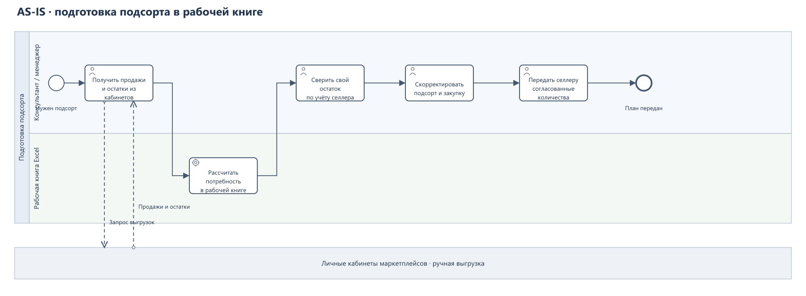

# Подсорт: процесс до и после StockFlow

В консалтинге мы готовили подсорт по выгрузкам площадок и рабочей книге, а доступный товар сверяли с учётом селлера. В StockFlow данные площадок обновлялись через API, менеджер подтверждал свой остаток и согласовывал отгрузку и закупку в одном месте. Заказы поставщику и поставки на площадки оформлял селлер.

## AS-IS: работа с подсортом

1. Мы получали продажи и остатки маркетплейсов из личных кабинетов; данные могли попадать в рабочую книгу через выгрузки.
2. Книга сопоставляла товары, недельные продажи и остатки площадок, рассчитывала дни покрытия и предлагаемое количество пополнения. Основные проверенные расчётные листы относятся к Ozon и Wildberries.
3. Реальный остаток собственного склада не задавался в проверенных формулах как ограничение: вместо него стояло заведомо большое число. Учёт собственного склада у разных селлеров вёлся в разных системах или таблицах.
4. На основе рекомендации и доступного товара принимали два решения: сколько отгрузить на склады площадок и сколько заказать у поставщика. Сверка данных из разных источников и согласование количества проходили вне общего рабочего пространства.

Такой процесс давал расчётную потребность, но требовал ручной сверки с отдельным учётом собственного склада.

## После внедрения StockFlow

| Шаг | Действие | Результат |
| --- | --- | --- |
| 1 | StockFlow автоматически получал продажи и остатки через API подключённых площадок. | Система показывала источник, время и состояние последнего обновления по каждому кабинету. |
| 2 | Менеджер сопоставлял идентификаторы товара в учёте селлера и на площадках. | Остатки и продажи не смешивались между разными товарами. |
| 3 | StockFlow рассчитывал рекомендацию по пополнению каждой площадки по правилам селлера. | Рядом с количеством были видны исходный остаток, темп продаж и целевой запас; менеджер не был обязан принимать рекомендацию. |
| 4 | Перед каждым утверждением менеджер заново подтверждал доступный остаток собственного склада. | Сервис предлагал распределение, не превышающее остаток, подтверждённый для этого решения. |
| 5 | StockFlow показывал недостающий объём отдельно от доступной отгрузки. | Менеджер видел предложение по закупке у поставщика. |
| 6 | Менеджер принимал рекомендацию, менял количества или отклонял её по своей стратегии. | Сохранялись исходный расчёт и решение; только утверждённые количества становились планами для исполнения селлером. |

Система помогала подготовить решение, но не подменяла коммерческую стратегию менеджера. Отклонённая рекомендация оставалась в истории и не становилась планом. StockFlow не оформлял автоматически заказ поставщику и не создавал поставки в кабинетах маркетплейсов: утверждённые количества передавали для исполнения на стороне селлера.

[Сквозной сценарий одного товара](04-USE-CASE.md) показывает расчёт, ограничение собственного склада и решение менеджера на синтетических данных.

## Три разных результата

- **Рекомендованная потребность маркетплейса** — расчётное количество без обещания, что весь объём доступен или будет отгружен.
- **План отгрузки** — количество, которое можно отправить с собственного склада после проверки его остатка.
- **Предложение по закупке** — недостающий объём, показанный отдельно от уже доступного товара.

Если остаток собственного склада отсутствовал или товар не был сопоставлен, StockFlow оставлял потребность видимой, но блокировал утверждение отгрузки и закупки. Менеджер не мог принять расчётную цифру за подтверждённую доступность товара.

## BPMN процесса

На AS-IS показаны ручные выгрузки и расчёт в книге. TO-BE начинается с доступной рекомендации; автоматическая синхронизация раскрыта отдельно в [диаграмме последовательности](08-API-CONTRACT.md#автоматическое-получение-данных). Утверждение в TO-BE завершает согласование плана, а исполнение остаётся на стороне селлера.

### AS-IS: рабочая книга

Форматы: [PNG](../assets/diagrams/09-bpmn-as-is.png) · [SVG](../assets/diagrams/09-bpmn-as-is.svg) · [BPMN](../assets/diagrams/09-bpmn-as-is.bpmn).

### TO-BE: решение менеджера

Форматы: [PNG](../assets/diagrams/10-bpmn-to-be.png) · [SVG](../assets/diagrams/10-bpmn-to-be.svg) · [BPMN](../assets/diagrams/10-bpmn-to-be.bpmn).
