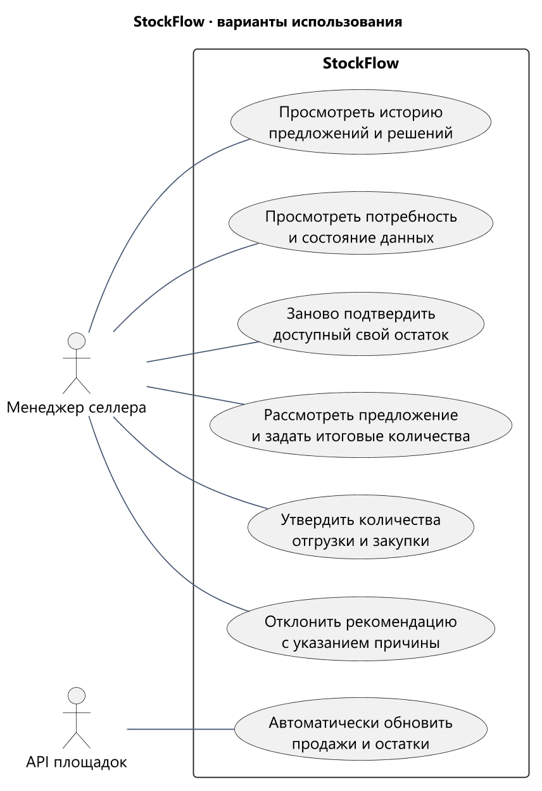
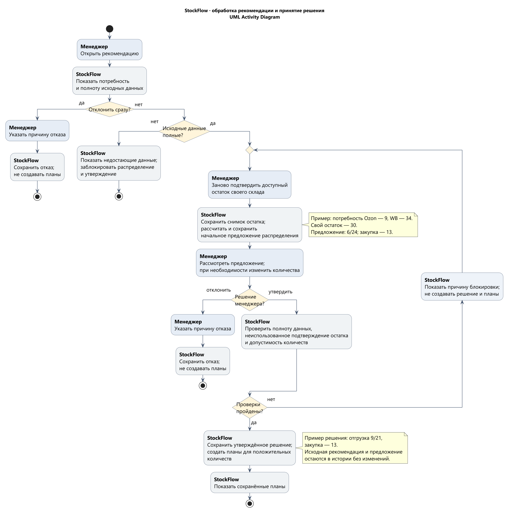

# UC-01. От рекомендации по подсорту к двум планам

Сценарий показывает основной путь одного товара через StockFlow. Все артикулы и количества ниже **синтетические**: они объясняют поведение сервиса и не раскрывают данные селлеров из исходной книги.

**Участники:** менеджер селлера, бэкофис-система StockFlow, API подключённых маркетплейсов и источник учёта собственного склада селлера. Закупку у поставщика и поставки на площадки после утверждения выполняли вне StockFlow.

## Основной путь

1. StockFlow автоматически получал продажи и остатки подключённых кабинетов через API площадок. Для каждого источника система показывала время и состояние последней синхронизации.
2. Система сопоставляла идентификаторы площадок с внутренним товаром селлера. Строки без однозначного сопоставления не смешивались с другим товаром.
3. По действующей версии правил StockFlow рассчитывал рекомендации для каждой площадки. Менеджер видел продажи, текущий остаток, целевое покрытие и объяснение предлагаемого количества.
4. Перед утверждением менеджер заново подтверждал доступный остаток собственного склада из учётной системы или таблицы селлера. StockFlow сохранял отдельный снимок и показывал, какую часть суммарной потребности можно обеспечить сейчас, а какую предлагалось заказать у поставщика.
5. Менеджер сопоставлял предложение со своей стратегией. Он мог принять количества, изменить их или отклонить рекомендацию. При изменении система проверяла, что суммарная текущая отгрузка не превышает подтверждённый остаток своего склада.
6. После утверждения StockFlow сохранял исходную рекомендацию, изменения менеджера, использованные данные и версию правил. Утверждённые количества составляли отдельные планы отгрузки и закупки. Исполнение оставалось на стороне селлера.

## Пример одного товара

В примере у селлера один внутренний товар `SKU-DEMO-01`, сопоставленный с карточками Ozon и Wildberries. Для наглядности обеим площадкам задано целевое покрытие **21 день**, округление целевого запаса задано вверх до целой штуки (`roundingPolicy: ceil`), а товар в пути не учитывается. Это настройки **данного примера**, а не обязательные значения для всех клиентов.

| Площадка | Продажи за 28 дней | Средний темп | Остаток на площадке | Рекомендация до учёта своего склада |
| --- | ---: | ---: | ---: | ---: |
| Ozon | 28 шт. | 1 шт./день | 12 шт. | `1 × 21 − 12 = 9 шт.` |
| Wildberries | 56 шт. | 2 шт./день | 8 шт. | `2 × 21 − 8 = 34 шт.` |
| **Всего** | | | | **43 шт.** |

На собственном складе селлера доступно **30 шт.** Полную рекомендацию в 43 шт. нельзя превратить в немедленную отгрузку: не хватает 13 шт. StockFlow сначала предлагал распределить 30 шт. пропорционально потребности. Доли `30 × 9 / 43 ≈ 6,28` и `30 × 34 / 43 ≈ 23,72` после распределения последней целой штуки дали **6 шт. для Ozon** и **24 шт. для Wildberries**.

| Площадка | Расчётная потребность | Начальное предложение StockFlow | Утвердил менеджер |
| --- | ---: | ---: | ---: |
| Ozon | 9 шт. | 6 шт. | 9 шт. |
| Wildberries | 34 шт. | 24 шт. | 21 шт. |
| **Всего** | **43 шт.** | **30 шт.** | **30 шт.** |

Менеджер изменил начальное предложение с 6/24 на **9/21**, исходя из своей стратегии. Он утвердил эти количества для отгрузки и отдельно включил **13 шт.** в план закупки для последующего пополнения. Сервис сохранил первоначальное предложение и его правку; закупленные 13 шт. не считались уже отправленными на площадку.

## Другие исходы

| Условие или решение | Поведение StockFlow |
| --- | --- |
| Нет нового подтверждения остатка своего склада для этого решения | Рекомендация площадкам видна, но исполнимую отгрузку и закупку утвердить нельзя. Фиксированного срока действия снимка нет; подтверждение из прежнего утверждения не переиспользуется. |
| Нет данных площадки из-за ошибки API | Ошибка синхронизации показана отдельно; отсутствие ответа не превращается в нулевые продажи или остаток. |
| Товар площадки не сопоставлен с внутренним товаром | Строка требует сопоставления и не прибавляется к запасу или спросу другого SKU. |
| Менеджер предлагает отгрузить больше 30 шт. | Система показывает превышение подтверждённого остатка и не даёт утвердить такой план. |
| Менеджер не согласен с рекомендацией | Он отклоняет её; отказ сохраняется, но план отгрузки или закупки не создаётся. Если предложение уже рассмотрено, решение сохраняет ссылку на него; ранний отказ обходится без подтверждения своего остатка. |
| Нет версии правила при полученных данных площадок | Количество не рассчитано, причина показана; распределение и утверждение заблокированы, отказ разрешён. |
| Менеджер утверждает только закупку или только отгрузку | Создаётся только план с положительным объёмом; второй план отсутствует. При обоих нулевых объёмах сохраняется решение без планов. |

Рекомендация, решение менеджера и фактическое исполнение — разные события. Утверждение количества в StockFlow не подтверждает, что поставщик принял заказ или маркетплейс принял поставку.

## Визуальное представление

### Варианты использования

Форматы: [PNG](../assets/diagrams/02-use-cases.png) · [SVG](../assets/diagrams/02-use-cases.svg) · [PlantUML](../assets/diagrams/02-use-cases.puml).

Автоматическое получение данных площадок показано отдельным вариантом использования. Собственный остаток подтверждает менеджер по учёту селлера.

### Обработка рекомендации и принятие решения

Форматы: [PNG](../assets/diagrams/06-recommendation-activity.png) · [SVG](../assets/diagrams/06-recommendation-activity.svg) · [PlantUML](../assets/diagrams/06-recommendation-activity.puml).

UML Activity Diagram показывает действия менеджера и системы: рассмотрение рекомендации, подтверждение своего остатка, утверждение или отказ. Если проверка не пройдена, система показывает причину, а менеджер исправляет данные и заново подтверждает остаток. При `incomplete` распределение и утверждение заблокированы, но рекомендацию можно отклонить. Исходные версии сохраняются в истории; новые данные создают новую рекомендацию.
