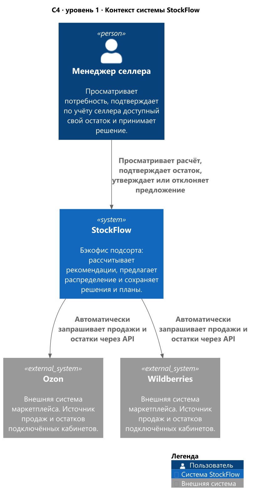
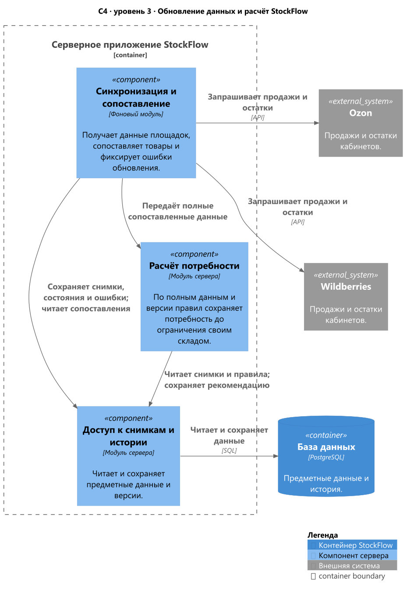
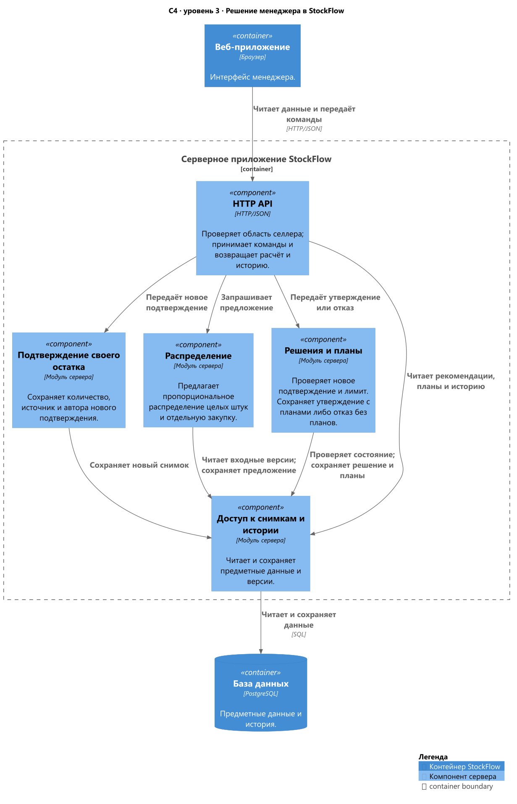

# Логическая архитектура StockFlow

StockFlow связывал автоматические данные маркетплейсов с остатком собственного склада селлера и решением менеджера. Ниже показаны обязанности частей сервиса и движение данных.

### C4 Context — уровень 1

Форматы: [PNG](../assets/diagrams/01-context.png) · [SVG](../assets/diagrams/01-context.svg) · [PlantUML](../assets/diagrams/01-context.puml).

На [контекстном уровне C4](https://c4model.com/diagrams/system-context) показаны StockFlow, его пользователь и прямые внешние зависимости — Ozon и Wildberries. Менеджер подтверждает свой остаток по учёту селлера; этот ручной процесс и дальнейшее исполнение планов раскрыты в BPMN.

### C4 Container — уровень 2

Форматы: [PNG](../assets/diagrams/03-c4-containers.png) · [SVG](../assets/diagrams/03-c4-containers.svg) · [C4-PlantUML](../assets/diagrams/03-c4-containers.puml).

На [уровне контейнеров C4](https://c4model.com/diagrams/container) показаны приложения и хранилища внутри StockFlow. Для кейса принята логическая декомпозиция на браузерное веб-приложение, серверное приложение и БД. Сервер предоставляет HTTP/JSON-контракт и выполняет автоматическую синхронизацию. Для хранения выбрана PostgreSQL. Язык и framework серверного приложения в материалах не зафиксированы.

### C4 Component — уровень 3

[Компонентный уровень C4](https://c4model.com/diagrams/component) раскрывает один контейнер — **серверное приложение StockFlow**. Ниже два вида этого контейнера: получение данных и работа с решением менеджера. Общий компонент «Доступ к снимкам и истории» и внешняя для сервера БД показаны в обоих видах.

#### Обновление данных и расчёт

Форматы: [PNG](../assets/diagrams/03-c4-components-data.png) · [SVG](../assets/diagrams/03-c4-components-data.svg) · [C4-PlantUML](../assets/diagrams/03-c4-components-data.puml).

#### Решение менеджера

Форматы: [PNG](../assets/diagrams/03-c4-components-decision.png) · [SVG](../assets/diagrams/03-c4-components-decision.svg) · [C4-PlantUML](../assets/diagrams/03-c4-components-decision.puml).

## Границы и обязанности

| Часть | За что отвечала |
| --- | --- |
| HTTP API | Принимал команды интерфейса и возвращал рекомендации, состояние синхронизации и историю. Проверял принадлежность данных области селлера. |
| Синхронизация и сопоставление | Получала продажи и остатки подключённых кабинетов через API и связывала товары площадки с внутренним SKU селлера. Сохраняла источник, время и результат; ошибки и несопоставленные строки не превращались в нулевые остатки или данные другого товара. |
| Расчёт потребности | Применял сохранённую версию правил к полным входным данным и фиксировал рекомендацию площадке до ограничения своим складом. |
| Подтверждение своего остатка | Перед каждым утверждением сохраняло новый снимок доступного количества, подтверждённого менеджером по учёту или таблице селлера. Способ учёта зависел от селлера. |
| Распределение | При дефиците своего товара предлагало пропорциональное распределение целых штук с детерминированным округлением; отдельно показывало недостающий объём для закупки. |
| Решения и планы | Проверяли новое подтверждение остатка и лимит отгрузки. Сохраняли утверждение и отдельные планы либо отказ без планов. Фиксированного срока действия снимка не задавалось. |
| Доступ к снимкам и истории | Читал и сохранял предметные данные, исходную рекомендацию, предложение, входные версии и решение. Поздние обновления не переписывали историю. |

## Хранение и утверждение

PostgreSQL хранит входные снимки, версии правил, рекомендации, предложения, решения и планы. Общие данные документов и их позиции разделены на связанные таблицы. HTTP API собирает записи в объект с вложенным списком `lines`.

Проверка подтверждённого остатка, сохранение решения, заголовков планов и позиций выполняются в одной транзакции. Ошибка отменяет сохранение целиком. Уникальность итогового решения и частичный уникальный индекс для использованного собственного остатка защищают от повторного утверждения. Правила количества и принадлежности селлеру проверяет сервер; ограничения базы дополняют эти проверки.

Общая Master ERD, подробные схемы таблиц и ограничения описаны в [реляционной модели](07-DATA-MODEL.md).

## Как проходил один цикл

1. Сервис обновлял данные кабинетов площадок и фиксировал состояние каждого обновления.
2. После сопоставления товаров рассчитывал потребность площадок. При отсутствии необходимых данных показывал причину, по которой количество нельзя подтвердить.
3. Менеджер заново подтверждал доступный остаток своего склада для этого утверждения. Без такого снимка потребность оставалась видимой, но исполнимые планы не утверждались.
4. Сервис предлагал, как распределить доступный товар, и отдельно показывал недостающий объём для закупки.
5. Менеджер утверждал, менял или отклонял предложение. Утверждение создавало планы; отклонение сохраняло решение без планов.

Планы фиксировали согласованные количества. Заказ поставщику и фактическую поставку на склады маркетплейсов выполняли вне StockFlow; сервис не выдавал утверждение за исполнение. Сквозной пример с числами приведён в [UC-01](04-USE-CASE.md), а сущности, которые сохраняли этот цикл, — в [модели данных](07-DATA-MODEL.md).

Входные данные, серверные проверки, порядок расчёта и атомарное сохранение объединены в [Backend-логике](18-BACKEND-LOGIC.md).
