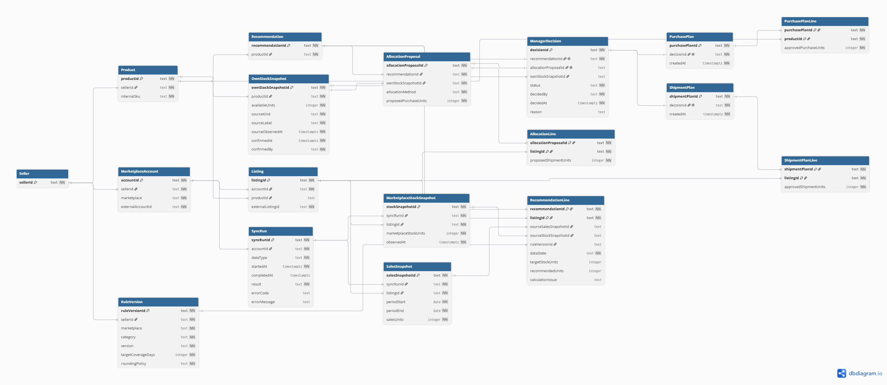
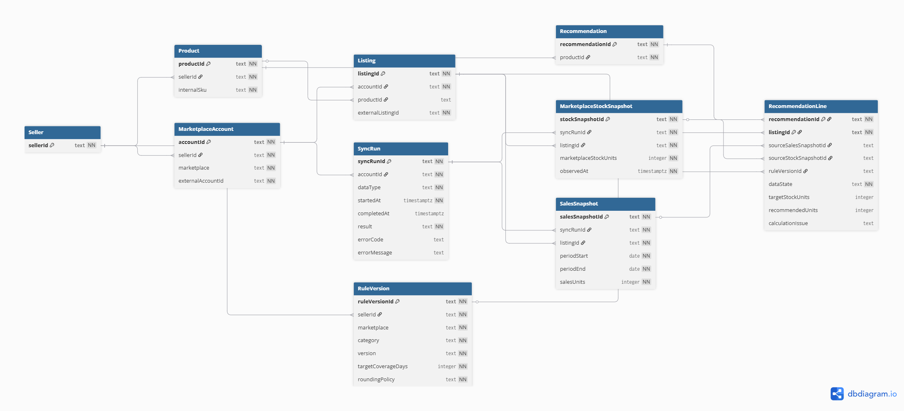

# Реляционная модель данных StockFlow · PostgreSQL

Модель описывает нормализованное хранение данных в PostgreSQL: таблицы, ключи и связи, необходимые для расчёта рекомендации и восстановления решения менеджера. Это документированная схема в составе портфельной реконструкции; она не является выгрузкой миграций действующего сервера.


### Master ERD — общая схема



Форматы: [PNG — полная схема](../assets/diagrams/00-master-erd.png) · [SVG — обзор ключей](../assets/diagrams/00-master-erd.svg) · [PlantUML — обзор](../assets/diagrams/00-master-erd.puml) · [master DBML](../assets/diagrams/00-master-erd.dbml).

Общая ERD объединяет 18 таблиц и 30 связей PostgreSQL. PNG показывает таблицы, поля и связи в экспорте dbdiagram.io. SVG и PlantUML дают компактный обзор первичных и внешних ключей с группировкой по назначению. Полные определения и ограничения собраны в master DBML.

### Источники и расчёт



Форматы: [PNG](../assets/diagrams/07-data-inputs.png) · [SVG](../assets/diagrams/07-data-inputs.svg) · [PlantUML](../assets/diagrams/07-data-inputs.puml) · [DBML](../assets/diagrams/07-data-inputs.dbml).

### Предложение, решение и планы


Форматы: [PNG](../assets/diagrams/08-data-decisions.png) · [SVG](../assets/diagrams/08-data-decisions.svg) · [PlantUML](../assets/diagrams/08-data-decisions.puml) · [DBML](../assets/diagrams/08-data-decisions.dbml).

Рекомендация, предложение и план остаются едиными бизнес-объектами. В базе общие данные документа хранятся один раз, а повторяющиеся позиции — в связанных таблицах `RecommendationLine`, `AllocationLine`, `ShipmentPlanLine` и `PurchasePlanLine`. Это убирает повторение общих данных и позволяет проверять связи с товарами и снимками через внешние ключи.

В ответе API заголовок и позиции собираются обратно в объект с массивом `lines`. Объект API и таблица базы не обязаны совпадать один к одному: `AllocationProposal.lines` возвращает позиции из `AllocationLine`, связанные через `allocationProposalId`.

Основной исходник — master DBML: каждая таблица определена один раз и содержит полный набор описанных полей и ограничений. В нём заданы общая схема и два подробных представления. Для отдельного импорта в [dbdiagram.io](https://dbdiagram.io) сохранены также два DBML-файла подробных схем; общие таблицы во второй схеме сокращены до данных, необходимых для контекста. Это одна база. Колонки `lines json` в модели нет.

Связь товара площадки с внутренним товаром необязательна до сопоставления. Снимок своего склада может использоваться в нескольких черновых предложениях, но подтверждает только одно утверждённое решение. Кардинальности не заменяют проверки статуса и принадлежности данных селлеру.

В экспорте DBML `1` и `*` показывают тип связи, а `NN` означает обязательное поле. Ссылка без `NN` может отсутствовать: например, товар площадки ещё не сопоставлен с внутренним товаром. В PlantUML `0..1` означает необязательный объект, `0..*` — любое количество, `1..*` — хотя бы один. Минимальное число позиций и правила статуса дополнительно проверяются при сохранении документа.

Идентификаторы и коды представлены типом `text`, количества — `integer`, границы окна продаж — `date`, моменты наблюдения и действий — `timestamptz`. Временные значения хранят момент времени независимо от часового пояса отображения.


| Сущность | Основные данные | Зачем сохранялась |
| --- | --- | --- |
| Селлер (`Seller`) | Идентификатор организации | Отделять товары, кабинеты, правила и решения разных клиентов. |
| Кабинет площадки (`MarketplaceAccount`) | Селлер, площадка, идентификатор кабинета | Не смешивать данные разных кабинетов одной площадки. |
| Внутренний товар (`Product`) | Селлер, внутренний артикул | Объединять потребность нескольких площадок и остаток своего склада по одному товару. |
| Товар площадки (`Listing`) | Кабинет, идентификатор площадки, ссылка на внутренний товар | Хранить сопоставление. До него строка остаётся несопоставленной и не участвует в расчёте другого SKU. |
| Обновление (`SyncRun`) | Кабинет, тип данных, время, результат или ошибка | Отличать успешное получение нуля от отсутствующего ответа API. |
| Снимки продаж и остатка площадки (`SalesSnapshot`, `MarketplaceStockSnapshot`) | Товар площадки, период и количество продаж либо остаток и время наблюдения; обновление-источник | Восстановить входные данные рекомендации, даже если продажи и остаток обновились в разное время. |
| Снимок своего склада (`OwnStockSnapshot`) | Внутренний товар, доступное количество, источник, время и автор нового подтверждения | Ограничивать отгрузку количеством, которое менеджер заново подтвердил для конкретного утверждения. |
| Версия правила (`RuleVersion`) | Область действия: селлер, площадка, категория; дни покрытия, округление, версия | Объяснить расчёт каждой площадки и сохранить настройки, действовавшие при принятии решения. |
| Рекомендация (`Recommendation`) | Идентификатор и внутренний товар | Сохранять общие данные исходного расчёта. |
| Позиция рекомендации (`RecommendationLine`) | Рекомендация, товар площадки, исходные снимки, версия правила, целевой запас и потребность либо причина отсутствия расчёта | Хранить потребность отдельной площадки и объяснять расчёт. |
| Предложение распределения (`AllocationProposal`) | Рекомендация, снимок своего склада, метод распределения и отдельный объём закупки | Сохранять общие данные предложения до правок менеджера. |
| Позиция распределения (`AllocationLine`) | Предложение, товар площадки и предложенное количество | Хранить распределение доступного остатка между площадками. |
| Решение менеджера (`ManagerDecision`) | Автор, время, статус, ссылка на рекомендацию, а при утверждении — на предложение распределения и заново подтверждённый снимок своего склада; причина изменения или отказа | Сохранить исходное предложение и последующее решение. Отклонить потребность можно и без снимка своего склада. |
| План отгрузки (`ShipmentPlan`) | Идентификатор, решение-основание и время создания | Объединять позиции утверждённой отгрузки. |
| Позиция плана отгрузки (`ShipmentPlanLine`) | План, товар площадки и утверждённое количество | Зафиксировать, куда и сколько решено отправить из своего запаса. |
| План закупки (`PurchasePlan`) | Идентификатор, решение-основание и время создания | Объединять позиции утверждённой закупки. |
| Позиция плана закупки (`PurchasePlanLine`) | План, внутренний товар и утверждённое количество | Зафиксировать, что и сколько решено закупить. |

Ключ позиции составной: идентификатор родительского документа и идентификатор товара. Например, `(allocationProposalId, listingId)` не позволяет дважды записать один товар площадки в одно предложение. Отдельный глобальный идентификатор позиции не требуется. Исходное предложение сохраняется отдельно от утверждённых планов.

В текущем сценарии решение принимается по одному внутреннему товару: оно может создать один план отгрузки и один план закупки. План отгрузки содержит строки площадок, а план закупки — строку этого товара. Объединение решений по разным товарам в общую поставку здесь не описано.

## Ограничения PostgreSQL и проверки сервера

В DBML зафиксированы первичные и внешние ключи, уникальность артикула в области селлера и товара в области кабинета, ограничения неотрицательных или положительных количеств, корректность периода продаж и допустимость статуса решения. Утверждённое решение требует ссылок на предложение и подтверждённый остаток; отказ требует непустую причину.

Повторное использование собственного остатка блокирует частичный уникальный индекс: снимок может участвовать в нескольких неутверждённых предложениях, но только в одном утверждённом решении.

```sql
CREATE UNIQUE INDEX manager_decision_approved_stock_unique
ON "ManagerDecision" ("ownStockSnapshotId")
WHERE "status" = 'approved';
```

Этот индекс дополняет экспорт DBML: обычная уникальность поля ограничила бы также решения с отказом. [Документация PostgreSQL об ограничениях](https://www.postgresql.org/docs/current/ddl-constraints.html).

Сервер проверяет наличие позиций, сумму отгрузок, связь расчёта с исходными снимками и версией правила, принадлежность данных одному селлеру и товару. Решение, заголовки планов и позиции сохраняются в одной транзакции; при ошибке вся операция отменяется. Эти проверки между таблицами дополняют ограничения `CHECK` отдельных строк.

## Как таблицы превращаются в ответ API

`salesUnits` и длина окна берутся из `SalesSnapshot` (границы периода включительно), остаток — из `MarketplaceStockSnapshot`, покрытие и `roundingPolicy` — из `RuleVersion`. Из `RecommendationLine` возвращаются целевой запас, количество и `calculationIssue`. Общий статус рекомендации и сумма потребностей вычисляются по её позициям: при хотя бы одном нерассчитанном количестве статус — `incomplete`, сумма — `null`.

`dataState` обозначает наличие снимков, а не готовность всего расчёта. Если снимки есть, но правило отсутствует, `dataState` остаётся `ready`, количество равно `null`, причина сохраняется в `calculationIssue`. Время подтверждения своего остатка имеет единое имя `confirmedAt` в таблице и API.

При отказе после рассмотрения предложения сервер сохраняет переданный `allocationProposalId` и выводит `ownStockSnapshotId` из него. Ранний отказ сохраняется без этих ссылок. Утверждённые количества хранятся в позициях планов; исходные строки предложения не изменяются.

## Правила целостности

- Все связи товара и кабинета проверяются в границах одного селлера. Совпадение артикула у разных селлеров не объединяет их остатки или спрос.
- Ошибка синхронизации и отсутствующее значение не равны нулю. Расчёт, требующий недоступных данных, получает явный статус и не превращается в подтверждённый план.
- Сумма утверждённых отгрузок одного внутреннего товара не превышает доступное количество в снимке собственного склада, связанном с рассмотренным предложением распределения.
- Каждое утверждение использует новое подтверждение своего остатка. Снимок, уже связанный с утверждённым решением, не подтверждает следующий план; фиксированного срока действия снимка нет.
- Количество в плане закупки не прибавляется к доступному остатку для текущей отгрузки.
- Сумма строк начального предложения равна меньшему из двух значений: доступный остаток своего склада или суммарная рассчитанная потребность. Предложение хранит версию метода распределения; правки менеджера записываются отдельно.
- Планы со своими списками возникают только после утверждения. Отклонение сохраняет рекомендацию и решение без планов.
- У каждого плана есть хотя бы один элемент `lines` с положительным целым количеством. Нулевой объём не создаёт строку или пустой план. Одно решение создаёт не более одного плана каждого типа.
- После решения ссылки на входные снимки и версию правила остаются неизменными. Последующие обновления создают новые снимки и рекомендации.

В [архитектуре](06-ARCHITECTURE.md) показано движение этих данных, а в [UC-01](04-USE-CASE.md) — пример решения по одному товару на двух площадках.

Входные данные, серверные проверки, порядок расчёта и атомарное сохранение объединены в [Backend-логике](18-BACKEND-LOGIC.md).
