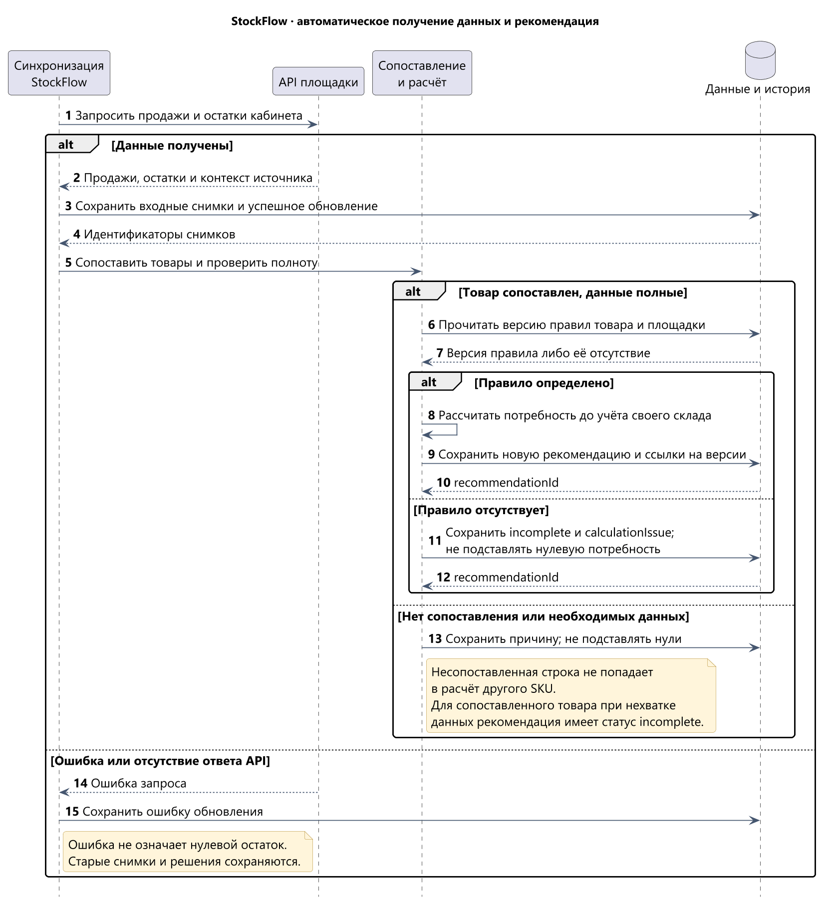
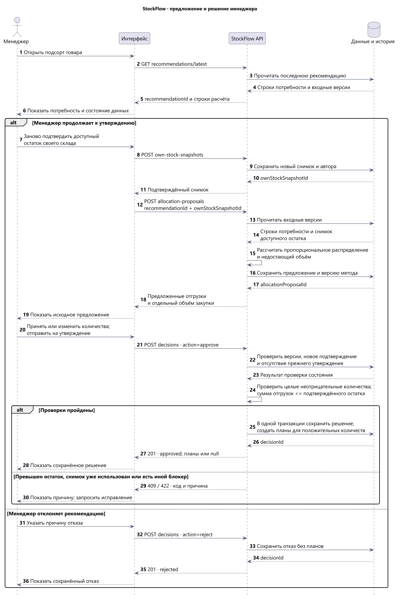

# Backend-логика StockFlow

[Архитектура C4](06-ARCHITECTURE.md) · [Правила расчёта](02-CALCULATION-RULES.md) · [PostgreSQL](07-DATA-MODEL.md) · [HTTP-контракт](08-API-CONTRACT.md) · [OpenAPI](09-OPENAPI.json).

## 1. Общий обзор

### Назначение

Серверная часть связывала продажи и остатки маркетплейсов с доступным товаром своего склада и решением менеджера. Она рассчитывала потребность, предлагала распределение дефицита, проверяла изменённые количества и сохраняла планы отгрузки и закупки.

Рекомендация, предложение распределения и решение сохранялись отдельно. Новые данные площадок не переписывали историю, а утверждение плана не означало фактического заказа или поставки.

### Высокоуровневая логика

1. Получить продажи и остатки кабинетов Ozon и Wildberries, сохранить состояние источников и сопоставить листинги с внутренними товарами.
2. Рассчитать потребность по конкретным снимкам и версии правила. При нехватке данных показать причину.
3. Принять новое подтверждение доступного остатка своего склада из учёта селлера.
4. Сформировать предложение распределения доступного товара и отдельно предложить закупку недостающего объёма.
5. Проверить решение менеджера: исходные или изменённые количества либо отказ.
6. Атомарно сохранить решение и положительные количества планов; при отказе сохранить решение без планов.

Документ объединяет серверный сценарий. [Статус технических моделей](case-stockflow.md#12-статус-сведений-и-материалы-кейса) описан в едином кейсе.

## 2. Входные данные

| Данные | Источник и основные поля | Для чего нужны |
| --- | --- | --- |
| Селлер, кабинет и товар | `sellerId`, `accountId`, `productId`, `listingId` и сопоставление `Listing.productId` | Отделить данные клиентов и объединить потребность площадок по внутреннему товару. |
| Продажи площадки | API площадки; `SalesSnapshot`: `periodStart`, `periodEnd`, `salesUnits`, `syncRunId` | Определить дневной темп за окно с включёнными границами. |
| Остаток площадки | API площадки; `MarketplaceStockSnapshot`: `marketplaceStockUnits`, `observedAt`, `syncRunId` | Определить текущую потребность площадки. |
| Правило покрытия | `RuleVersion`: селлер, площадка, категория, `targetCoverageDays`, `roundingPolicy` и версия | Рассчитать целевой запас и сохранить основание расчёта. |
| Остаток своего склада | Менеджер: `availableUnits`, `sourceKind`, `sourceLabel`, `sourceObservedAt` | Ограничить текущую отгрузку доступным количеством. |
| Запрос предложения | `recommendationId`, `ownStockSnapshotId` | Зафиксировать входные версии для распределения. |
| Утверждение | `recommendationId`, `allocationProposalId`, `action: approve`, `shipmentLines`, `purchaseUnits`, необязательная причина | Сохранить исходные или изменённые количества. |
| Отказ | `recommendationId`, `action: reject`, обязательная непустая `reason`, необязательный `allocationProposalId` | Зафиксировать решение без создания планов. |

`sourceKind` собственного остатка принимает `accounting_system` или `seller_table`. `confirmedAt`, `confirmedBy`, `decidedAt` и `decidedBy` фиксирует сервер; клиент не подменяет автора действия. Способ получения контекста пользователя в кейсе не реконструирован.

## 3. Валидации

### Структура и область данных

- Обязательные поля, типы и допустимые действия соответствуют [OpenAPI](09-OPENAPI.json). Дробные и отрицательные количества не принимаются.
- Ресурсы принадлежат одному селлеру и внутреннему товару. Совпадение артикула в разных кабинетах не даёт права смешивать данные.
- Каждая позиция `shipmentLines` ссылается на листинг исходной рекомендации. Один `listingId` не может повторяться.
- Остаток своего склада содержит источник и время наблюдения. Новое подтверждение хранится отдельным снимком.

### Бизнес-проверки

| Проверка | Правило |
| --- | --- |
| Полнота расчёта | Для распределения и утверждения рекомендация должна быть `ready`; `incomplete` допускает просмотр и отказ. |
| Подтверждение своего склада | Каждое утверждение требует нового подтверждения. Снимок, использованный в утверждённом решении, повторно не принимается; фиксированного TTL нет. |
| Ограничение отгрузки | Сумма утверждаемых отгрузок не превышает `availableUnits` выбранного снимка. Закупка не увеличивает доступный остаток текущей отгрузки. |
| Право менеджера изменить предложение | Несовпадение с начальной пропорцией само по себе не является ошибкой. Итоговые количества проходят общие проверки. |
| Окончательность решения | По рекомендации сохраняется одно итоговое решение. Повторное или одновременное утверждение не создаёт новые планы. |
| Отказ | Причина обязательна. Ранний отказ не требует подтверждения своего склада и предложения; поздний сохраняет ссылки на рассмотренное предложение и снимок. |

## 4. Основная логика

### Шаг 1. Получить данные и сохранить состояние источника

StockFlow сам выполняет чтение API подключённых площадок. Менеджер не загружает продажи и остатки через внутренние операции кейса. Для каждого обновления сохраняется `SyncRun`: кабинет, тип данных, время и результат либо ошибка.

Продажи и остатки могут поступать разными обновлениями. Снимки сохраняют связь с конкретным запуском и листингом. Несопоставленный листинг остаётся видимым как проблема сопоставления и не присоединяется к чужому товару по совпавшему артикулу.

Ошибка или отсутствие ответа API не создаёт нулевые продажи и остатки. Внутренний `sync-state` показывает продажи и остатки раздельно: `success`, `error` или `not_started`, время обновления, ошибку и число несопоставленных листингов. Последний успешный ответ не выдаётся за успешное новое обновление.

Расписание, размер страниц, лимиты и интервалы повторного чтения внешних API не заданы материалами кейса. Этот документ не вводит для них неподтверждённые значения.

### Шаг 2. Рассчитать и зафиксировать рекомендацию

Для каждой строки площадки сервер выбирает входные снимки и версию правила, затем рассчитывает:

1. `salesWindowDays = periodEnd − periodStart + 1`.
2. `dailyRate = salesUnits / salesWindowDays`.
3. `targetStockUnits = округление(dailyRate × targetCoverageDays)` по `roundingPolicy` версии правила.
4. `recommendedUnits = max(0, targetStockUnits − marketplaceStockUnits)`.

Успешно полученные нулевые продажи дают нулевую потребность. Дни покрытия при нулевом темпе не вычисляются делением на ноль.

`dataState` отражает наличие снимков: `ready`, `missing_sales`, `missing_stock` или `missing_both`. Если снимки есть, но правило отсутствует, `dataState` остаётся `ready`, однако `recommendedUnits` и общий `totalRecommendedUnits` равны `null`, заполнен `calculationIssue`, а статус рекомендации — `incomplete`. Отсутствие данных не подменяется нулём.

`Recommendation` относится к одному внутреннему товару, а `RecommendationLine` хранит расчёт по листингу и ссылки `sourceSalesSnapshotId`, `sourceStockSnapshotId`, `ruleVersionId`. Исторические входы сохраняются для восстановления решения.

### Шаг 3. Принять подтверждение своего склада

Сервер проверяет товар, доступное целое неотрицательное количество и сведения об источнике. Затем сохраняет `OwnStockSnapshot` с временем и автором подтверждения.

`sourceObservedAt` описывает момент наблюдения в учёте селлера, `confirmedAt` — новое подтверждение в StockFlow. Сервис не считает подтверждение резервированием товара в учётной системе. Нулевой собственный остаток допустим: потребность площадок может привести только к закупке.

### Шаг 4. Сформировать предложение распределения

Сервер принимает конкретные `recommendationId` и `ownStockSnapshotId` и проверяет, что они относятся к одному селлеру и товару. Для полной рекомендации с суммарной потребностью `D` и доступным остатком `A`:

- если `D = 0`, предложенная отгрузка и закупка равны нулю;
- если `A ≥ D`, каждой площадке предлагается её потребность, закупка равна нулю, лишний товар остаётся на своём складе;
- если `A < D`, доступный товар распределяется пропорционально потребности: `доля = A × потребность строки / D`.

При дефиците сначала берутся целые части долей. Оставшиеся штуки передаются строкам с наибольшими дробными остатками; при равенстве используется стабильный порядок идентификаторов листингов. Метод сохраняется как `proportional_largest_remainder_v1`.

Сумма предложенных отгрузок равна `min(A, D)`, `proposedPurchaseUnits = D − min(A, D)`. Предложение и его позиции сохраняются в `AllocationProposal` и `AllocationLine`. Новая редакция решения менеджера не переписывает эти строки.

В примере UC-01 потребность Ozon/WB — 9/34, доступно 30: предложение составляет 6/24 к отгрузке и 13 к закупке. Менеджер может утвердить 9/21 и 13; исходные 6/24 остаются в истории.

### Шаг 5. Обработать решение менеджера

**При утверждении** сервер получает предложение, а через него — рекомендацию и принятый снимок своего склада. Проверяются состояние рекомендации, принадлежность ресурсов, повторное использование подтверждения, уникальность листингов, типы и сумма количеств. Исходные или изменённые количества сохраняются как итог менеджера.

**При отказе** сервер требует непустую причину и сохраняет `ManagerDecision` со статусом `rejected`. Если предложение ещё не формировалось, ссылки на предложение и собственный снимок равны `null`; если менеджер рассмотрел предложение, сохраняются его ссылки. Планы не создаются.

Статус команды `action: approve/reject` отличается от сохранённого статуса `approved/rejected`. Автор и время итогового решения определяются сервером.

### Шаг 6. Сохранить решение и планы в одной транзакции

1. Начать транзакцию и повторно проверить состояние рекомендации, связь входных снимков и рекомендации и пригодность подтверждения своего склада.
2. Сохранить одно итоговое `ManagerDecision` с исходными ссылками, автором, временем и причиной, когда она задана.
3. При утверждении сохранить `ShipmentPlan` и положительные `ShipmentPlanLine`, если есть положительная отгрузка.
4. Сохранить `PurchasePlan` и положительную `PurchasePlanLine`, если закупка больше нуля.
5. Зафиксировать транзакцию. При любой ошибке отменить решение, заголовки и позиции целиком.

При нулевом объёме соответствующий план не создаётся и возвращается как `null`. Закупка без отгрузки, отгрузка без закупки и утверждение обоих нулевых объёмов допустимы; в последнем случае сохраняется решение без планов. Новое подтверждение своего склада требуется и для утверждения только закупки.

Уникальность итогового решения и частичный уникальный индекс по `ManagerDecision.ownStockSnapshotId` для `status = approved` дополняют серверные проверки. При двух конкурирующих запросах сохраняется только один допустимый результат, второй получает `409`. Конкретный уровень изоляции и способ блокировок в реконструкции не заданы. Ограничения и SQL индекса приведены в [модели PostgreSQL](07-DATA-MODEL.md).

## 5. Интеграции и хранение

| Источник или хранилище | Чтение | Запись |
| --- | --- | --- |
| API Ozon и Wildberries | Продажи и остатки подключённых кабинетов. | В основном сценарии записи на площадки нет: утверждение не создаёт поставку. |
| Учёт селлера | Менеджер сверяет доступное количество в системе или таблице. | Автоматическое резервирование и заказ поставщику не входят в кейс. |
| PostgreSQL | Товары, сопоставления, снимки, версии правил, рекомендации, предложения и история решений. | `SyncRun`, входные снимки, расчёт, подтверждение своего склада, предложение, решение, планы и позиции. |

Регламент свежести данных и интеграции с учётом своего склада требуют отдельного уточнения.

## 6. Исключительные случаи

| Ситуация | Поведение |
| --- | --- |
| API площадки недоступен или не ответил | Сохранить ошибку обновления, показать состояние источника; не заменять данные нулём и не переписывать историю. |
| Листинг не сопоставлен с товаром | Показать проблему сопоставления; не использовать его для другого SKU. |
| Нет снимка или правила | Оставить количество нерассчитанным, указать причину; блокировать предложение и утверждение, разрешить отказ. |
| Неправильная форма запроса | `400`; данные и планы не сохраняются. |
| Чужой или недоступный ресурс | `404`; не раскрывать данные другого селлера. |
| Рекомендация уже решена или подтверждение использовано | `409`; повторное решение и новые планы не создаются. |
| Отгрузка больше доступного остатка, дробное или отрицательное количество, повтор листинга | `422`; значения не исправляются молча. |
| Ошибка записи решения или любой позиции | Откатить всю транзакцию; частичное решение и планы не остаются. |

Ошибки контракта содержат `code` и `message`. Примеры кодов: `STOCK_LIMIT_EXCEEDED`, `OWN_STOCK_RECONFIRMATION_REQUIRED`, `DATA_UNAVAILABLE`. Доступ к серверу после неопределённого сбоя не означает, что можно создавать второе итоговое решение: правило уникальности сохраняется.

## 7. Выходные данные

| Результат | Что получает интерфейс |
| --- | --- |
| Состояние синхронизации | Отдельные результаты продаж и остатков, время, ошибка, число несопоставленных листингов. |
| Рекомендация | `recommendationId`, статус, общая потребность или `null`, строки расчёта, причины и ссылки на входные версии. |
| Подтверждение своего склада | Идентификатор снимка, доступное количество, источник, время наблюдения и подтверждения, автор. |
| Предложение | Идентификатор, рекомендация, свой снимок, метод, строки предложенной отгрузки и объём закупки. |
| Решение | `decisionId`, `approved/rejected`, автор, время, причина и ссылки; `shipmentPlan` и `purchasePlan` с положительными строками либо `null`. |

Заголовки и позиции физически хранятся раздельно, но API собирает их во вложенные `lines`. Отдельных HTTP-операций для `RecommendationLine`, `AllocationLine` или позиций планов нет. Полные схемы и все семь операций определены в [OpenAPI](09-OPENAPI.json).

## 8. Неизменность истории и границы результата

Решение ссылается на сохранённую рекомендацию, рассмотренное предложение и собственный снимок, а строки рекомендации — на снимки площадок и правило расчёта. Позднее обновление API, новое правило или другой собственный остаток не меняют эти версии и утверждённые количества.

Снимок собственного склада не заменяет резервирование. Между подтверждением и фактической отгрузкой запас может измениться во внешнем учёте. План фиксирует согласованное количество; исполнение остаётся за селлером.

Товар в пути, сезонность, сроки поставки, кратность коробов и автоматические закупки не включены в базовую формулу. Проверки прототипа и серверной части разделены в [НФТ](17-NON-FUNCTIONAL-REQUIREMENTS.md).

## 9. Диаграммы и проверка сценария

### Получение данных

[Полный размер](../assets/diagrams/04-sequence-sync.png) · [PlantUML](../assets/diagrams/04-sequence-sync.puml).

### Предложение, решение и планы

[Полный размер](../assets/diagrams/05-sequence-decision.png) · [PlantUML](../assets/diagrams/05-sequence-decision.puml).

Проверки основного сценария и исключений собраны в [критериях приёмки КП-01–КП-20](05-ACCEPTANCE-CRITERIA.md), ограничения качества — в [НФТ](17-NON-FUNCTIONAL-REQUIREMENTS.md), пример изменения распределения — в [UC-01](04-USE-CASE.md). Состав операций и сущностей соответствует существующему контракту.
