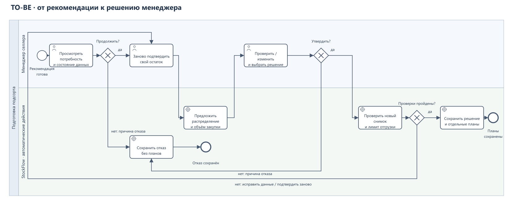
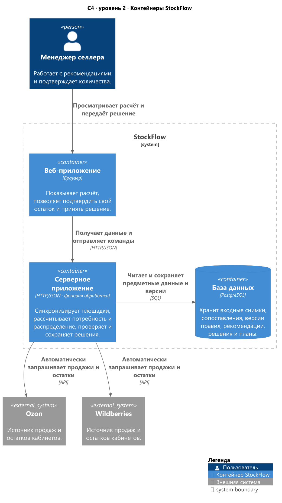
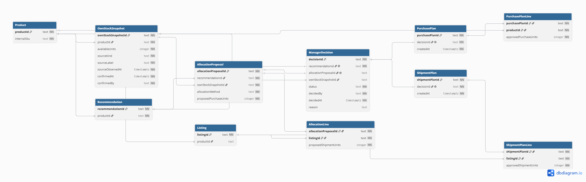

# StockFlow — от потребности к решению о подсорте

## 1. Кейс за минуту

StockFlow — бэкофис-система для планирования пополнения запасов на маркетплейсах. Она получает продажи и остатки площадок через API, рассчитывает потребность и помогает менеджеру согласовать отгрузку со своего склада и закупку у поставщика.

Я занимался бизнес- и системным анализом: разобрал ручной процесс подсорта, описал правила и исключения, связал требования, модель данных и API. Важным для меня было сохранить исходное предложение и право менеджера изменить его.

По моему опыту, подсорт для селлера с 1–2 кабинетами занимал **60–120 минут вручную** и **до 30 минут в StockFlow**. Сравнение с циклом в 30 минут даёт **расчётное сокращение на 50–75%**. Состав цикла и условия оценки приведены в разделе результатов.

## 2. Контекст и проблема

В консалтинге мы работали с разными селлерами. Продажи и остатки площадок получали из личных кабинетов или выгрузок. В рабочей книге сопоставляли артикулы, суммировали продажи по неделям и рассчитывали количество для пополнения.

Остаток своего склада каждый селлер вёл в собственной системе или таблице. Чтобы подготовить подсорт, требовалось сверить расчёт с этим учётом, распределить доступный товар и решить, что докупить. Я хотел связать эти действия в одном рабочем месте и сохранить объяснение итоговых количеств.

## 3. Моя роль и ключевые решения

Я сформулировал требования и критерии приёмки, проработал расчёт и описал взаимодействие интерфейса, сервера и базы данных. В основу решения положил три правила:

1. **Ограничивать текущую отгрузку доступным запасом.** Расчёт показывает потребность площадки, а подтверждённый остаток своего склада — сколько можно отправить сейчас. Недостающий объём предлагается к закупке.
2. **Сохранять предложение и решение отдельно.** Менеджер может изменить распределение или отказаться. В истории остаются исходные и итоговые количества.
3. **Отделять план от исполнения.** StockFlow фиксирует согласованные количества. Заказ поставщику и фактическую поставку выполняет селлер.

Эти правила я связал с требованиями, критериями приёмки, ERD, API и прототипом. Обязанности участников описаны в [карте стейкхолдеров](11-STAKEHOLDERS.md).

## 4. Процесс до и после

До StockFlow мы вручную собирали выгрузки, считали потребность в книге и сверяли её с учётом селлера. В формулах стояло условное ограничение количества; фактический остаток склада приходилось проверять отдельно.

В StockFlow данные площадок обновлялись через API. Менеджер видел расчёт потребности, подтверждал свой остаток и рассматривал предложение по отгрузке и закупке. Он мог утвердить количества, изменить их или отказаться. При утверждении появлялись планы, при отказе сохранялись решение и причина.

[BPMN AS IS](../assets/diagrams/09-bpmn-as-is.png) и [BPMN TO BE](../assets/diagrams/10-bpmn-to-be.png) показывают участников и порядок действий. Подробности — в [описании процесса](01-PROCESS-AS-IS-TO-BE.md).

В PDF обе BPMN размещены в приложениях 1 и 2.

## 5. Правила расчёта

Для базового сценария без товара в пути и дополнительных коэффициентов:

- Дневной темп = продажи в штуках / число календарных дней окна. Обе границы периода включаются.
- Целевой запас = дневной темп × целевые дни покрытия, с округлением по сохранённой версии правила.
- Потребность = положительная разница между целевым запасом и остатком площадки. Отрицательная разница становится нулём.

Рекомендация сохраняет ссылки на использованные снимки продаж, остатка и версию правила. Если данных или правила нет, количество остаётся нерассчитанным: `null`, статус `incomplete`, причина в `calculationIssue`. Такую рекомендацию можно посмотреть или отклонить; распределение и утверждение блокируются.

При дефиците товар распределяется пропорционально потребности. Сначала берутся целые части долей, оставшиеся штуки передаются площадкам с наибольшими дробными остатками. При равенстве используется стабильный порядок идентификаторов листингов.

Перед каждым утверждением менеджер заново подтверждает доступный остаток своего склада. Уже использованное подтверждение повторно не принимается; фиксированного срока действия снимка нет. Полные формулы приведены в [правилах расчёта](02-CALCULATION-RULES.md).

## 6. Сквозной пример решения

Пример на демонстрационных данных:

| Этап | Ozon | Wildberries |
| --- | --- | --- |
| Рассчитанная потребность | 9 шт. | 34 шт. |
| Предложенное распределение доступных 30 шт. | 6 шт. | 24 шт. |
| Утверждённая менеджером отгрузка | 9 шт. | 21 шт. |

Всего нужно 43 шт., на своём складе доступно 30. Пропорциональное распределение даёт 6/24, ещё 13 шт. предлагаются к закупке.

Менеджер меняет распределение на 9/21 и утверждает его вместе с закупкой 13 шт. История сохраняет оба варианта. Текущая отгрузка составляет 30 шт.; будущая закупка учитывается отдельно.

Возможны отказ, только закупка, только отгрузка или решение с обоими нулевыми объёмами. Нулевой объём не создаёт пустого плана. Все исходы описаны в [UC-01](04-USE-CASE.md).

## 7. Архитектура и интеграции

Я описал архитектуру в C4: контекст, контейнеры и два представления компонентов сервера. На уровне контейнеров показаны браузерное веб-приложение, сервер и PostgreSQL. Внешние системы — Ozon и Wildberries.

Сервер получает данные площадок, сопоставляет товары, рассчитывает потребность, проверяет решение и сохраняет планы. Продажи и остатки могут обновляться разными запусками; рекомендация хранит ссылки на конкретные снимки. Доступный остаток своего склада подтверждает менеджер по учёту селлера.

Схема размещена в приложении 3 к PDF. Все уровни C4 и обязанности компонентов доступны в [архитектуре](06-ARCHITECTURE.md).

## 8. Данные и сохранение решения

Я связал в модели PostgreSQL товары и листинги, входные снимки, правила, рекомендации, предложения, решения и планы. Master ERD показывает общую структуру; две подробные схемы раскрывают расчёт и принятие решения.

Заголовок документа и его позиции хранятся в связанных таблицах. `AllocationProposal` содержит общие данные предложения и ссылку на свой остаток, `AllocationLine` — количество по листингу. API собирает их в один объект с вложенными `lines`.

Решение и планы сохраняются в одной транзакции. Сервер проверяет количество, использованные снимки и версию правила; ограничения уникальности защищают от повторного решения и использования прежнего подтверждения остатка. Ошибка отменяет всю запись.

Эта ERD размещена в приложении 4 к PDF. Таблицы, ключи и ограничения описаны в [модели PostgreSQL](07-DATA-MODEL.md).

## 9. Контракт интерфейса и API

Я описал семь операций: просмотр синхронизации и рекомендаций, подтверждение своего остатка, получение предложения, сохранение и чтение решения. Перед записью сервер проверяет доступ к ресурсам селлера, состояние рекомендации и допустимость количеств.

Ошибки разделены по причинам: неправильная форма запроса — `400`, недоступный ресурс — `404`, повторное решение или использованное подтверждение — `409`, нарушение правил данных и количества — `422`. Ответ содержит машинный код и понятное сообщение.

[HTTP-контракт](08-API-CONTRACT.md) объясняет операции и исключения, [OpenAPI 3.1](09-OPENAPI.json) содержит схемы запросов и ответов, [Backend-логика](18-BACKEND-LOGIC.md) — порядок серверной обработки.

## 10. Риски и качество

Я предусмотрел проверки для неполных данных, неправильного сопоставления товара, изменения своего остатка и повторного утверждения. Перед сохранением сервер проверяет источники, подтверждение остатка и сумму количеств; исходное предложение остаётся в истории.

Проверки доступа, конкурентных запросов, ошибок и интерфейса собраны в [НФТ](17-NON-FUNCTIONAL-REQUIREMENTS.md). Связанные материалы — [риски](13-RISKS-MITIGATION.md), [ограничения](12-CONSTRAINTS-DEPENDENCIES.md) и [критерии приёмки](05-ACCEPTANCE-CRITERIA.md).

## 11. Результаты и критерии успеха

Для меня главным результатом было собрать расчёт, проверку доступного товара и решение в одном процессе. Менеджер видел исходное предложение и последствия своей правки, а исполнители получали отдельные планы отгрузки и закупки.

В клиентском портфеле было **23 селлера и 72 кабинета**: 27 Ozon, 23 WB, 14 Яндекс Маркета, 6 Мегамаркета и 2 Lamoda. В этом кейсе я подробно разобрал WB и Ozon — **50 кабинетов**.

По моему опыту, ручной подсорт для селлера с 1–2 кабинетами занимал **60–120 минут**, обычный цикл в StockFlow — **до 30 минут активной работы менеджера**. Сравнение с циклом в 30 минут даёт **расчётное сокращение на 50–75%**.

Пример распределения времени внутри цикла:

| Этап | Оценочная разбивка |
| --- | ---: |
| Проверка рекомендаций и проблемных данных | До 5 минут |
| Сверка и подтверждение своего остатка | До 10 минут |
| Корректировка распределения и закупки | До 10 минут |
| Проверка и утверждение планов | До 5 минут |
| **Всего** | **До 30 минут** |

Я оценивал обычный цикл при готовых данных, доступном учёте склада и ограниченном числе корректировок. Ожидание API, ответа селлера и дополнительного согласования учитывается отдельно. Подробности — в [результатах](14-RESULTS.md) и [критериях успеха](15-PROJECT-SUCCESS.md).

## 12. Статус сведений и материалы кейса

### На чём основан кейс

| Материал | Основание |
| --- | --- |
| Рабочий процесс и масштаб | Мой опыт подсорта в консалтинге и перечень клиентских кабинетов. |
| Время до и после | Моя оценка обычных циклов для селлера с 1–2 кабинетами. Период наблюдения, число товаров и журнал инструментальных замеров не зафиксированы. |
| Сокращение на 50–75% | Расчёт для цикла в 30 минут относительно прежних 60–120 минут. Разбивка этапов иллюстрирует состав работы. |
| Технические модели | Для портфолио я восстановил BPMN, C4, PostgreSQL/DBML и внутренний API. Язык сервера, механизм входа, матрица доступа и расписание синхронизации не уточнены. |
| Прототип | Демо на вымышленных данных; изменения хранятся в браузере. Его тесты проверяют расчёты и ограничения интерфейса. |

Оценка времени относится к подготовке и утверждению планов. Рост продаж, снижение дефицита и финансовый эффект в деньгах я не оценивал. Серверная авторизация, транзакции PostgreSQL и интеграции требуют отдельной проверки; целевые показатели такого испытания указаны в НФТ.

### Где смотреть подробности

В кейсе собраны требования, правила, критерии приёмки, C4, BPMN, диаграммы последовательности и действий, Master ERD, DBML и OpenAPI. [Backend-логика](18-BACKEND-LOGIC.md) связывает серверные проверки и сохранение, [каталог диаграмм](10-DIAGRAMS.md) содержит изображения и исходники.

В прототипе можно подтвердить остаток, изменить распределение, утвердить планы или отказаться, посмотреть историю и скачать CSV. В [направлениях развития](16-EXPANSION-PLANS.md) я выделил интеграцию с учётом селлера, товар в пути и обратную связь об исполнении. Рабочую книгу с данными клиентов я не публикую.
